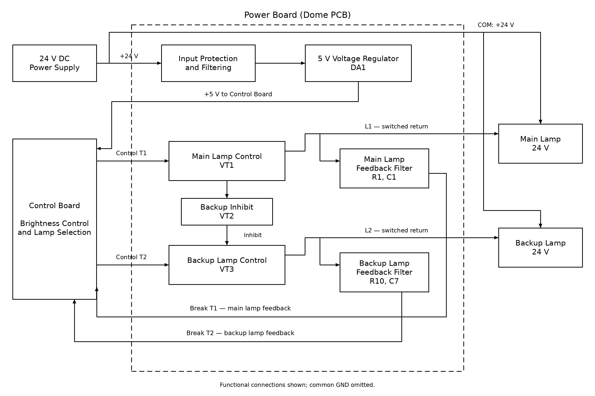
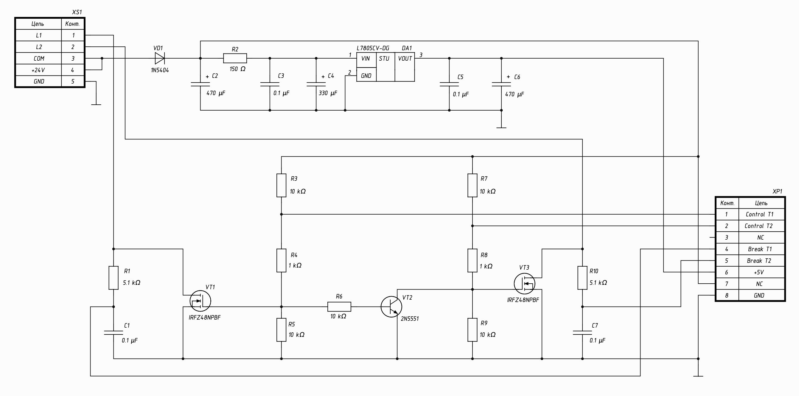
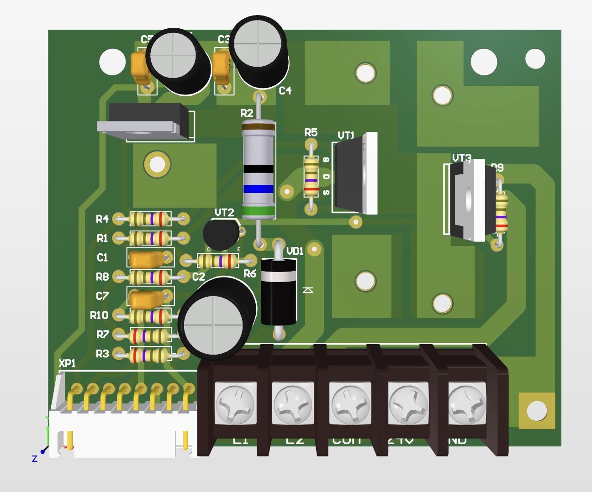
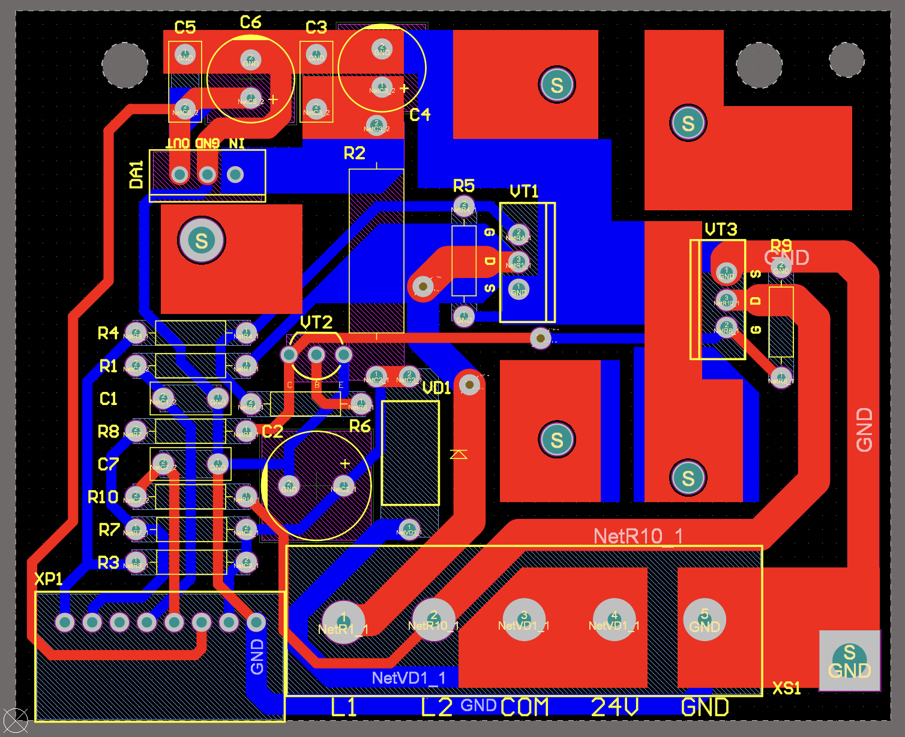
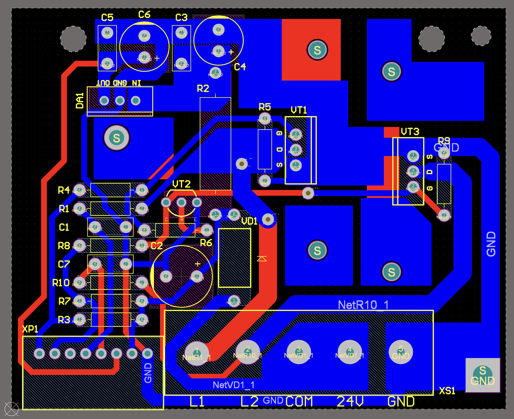
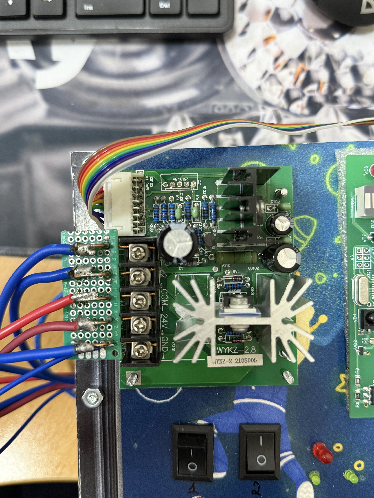

# Power Board

A power board for a luminaire with a **24 V main incandescent lamp and a backup lamp**. It receives separate lamp-control signals from an external control board and provides lamp feedback for fault monitoring. Brightness regulation and the decision to switch to the backup lamp are handled by the control board.

The repository contains the Altium Designer project, PCB views, fabrication files, BOM, and original Russian engineering documentation.

## My Contribution

This project is based on a board design created before my involvement. I transferred the existing design to **Altium Designer** and prepared the schematic, PCB layout, component libraries, bill of materials, and engineering documentation.

My work included component selection, standardizing schematic symbols and footprints, clarifying component parameters, and aligning the schematic, PCB, and documentation. I also **personally assembled and soldered the board**.

## Block Diagram

The board contains two lamp-control channels, a backup-channel inhibit circuit, feedback filters, and a 5 V regulator. The main and backup lamps share the +24 V common terminal. The regulator supplies the external control board through XP1.

## Schematic

VT1 and VT3 are IRFZ48NPBF N-channel MOSFETs controlling the main and backup lamp return paths. VT2 inhibits the backup channel while the main channel is enabled. The R1/C1 and R10/C7 networks filter the lamp-node feedback signals, routed to the control board as **Break T1** and **Break T2**.

VD1 and the input filtering network feed the L7805CV-DG regulator (DA1), which provides **+5 V** for the control board. The lamps connect between **COM and L1** (main) and **COM and L2** (backup).

### Connections

| Connector | Pin | Signal | Function |
| --- | ---: | --- | --- |
| XS1 | 1 | L1 | Main lamp switched return |
| XS1 | 2 | L2 | Backup lamp switched return |
| XS1 | 3 | COM | Lamp common, connected to +24 V |
| XS1 | 4 | +24 V | Power input |
| XS1 | 5 | GND | Common ground |
| XP1 | 1 | Control T1 | Main lamp control input |
| XP1 | 2 | Control T2 | Backup lamp control input |
| XP1 | 3 | NC | Not connected |
| XP1 | 4 | Break T1 | Main lamp feedback output |
| XP1 | 5 | Break T2 | Backup lamp feedback output |
| XP1 | 6 | +5 V | Supply output to the control board |
| XP1 | 7 | NC | Not connected |
| XP1 | 8 | GND | Common ground |

## PCB

### 3D View

### Top Layer

### Bottom Layer

The PCB uses **two copper layers** and through-hole components mounted on one side. A five-position terminal block connects the power supply and lamps; an eight-position connector provides the control-board interface.

## Assembled Board and Test Bench

The assembled power board is mounted on a demonstration stand and connected to the control board. The close-up shows the lamp and supply terminals, inter-board cable, and heatsinks.
In the system, the control board sets lamp brightness and processes lamp feedback. When a main-lamp failure is detected, it commands the power board to select the backup lamp.

### Hardware and Documentation Versions

The photographs show hardware that I assembled and soldered. Some photographed boards are earlier versions and may differ from the published Altium files in component placement, markings, or implementation details. The Altium files and engineering documents describe the version prepared during my work on the project.

## Bill of Materials

| Designators | Qty | Value / Part | Description | Manufacturer | Part Number | Package |
| --- | ---: | --- | --- | --- | --- | --- |
| C1, C3, C5, C7 | 4 | 0.1 µF | Ceramic capacitor, 50 V, 20% | Murata | RDEF51H104Z0K1C03B | THT |
| C2 | 1 | 470 µF | Aluminum electrolytic capacitor, 35 V, 20% | Jamicon | TKR471M1VG16M | THT |
| C4 | 1 | 330 µF | Aluminum electrolytic capacitor, 35 V, 20% | EPCOS | B41851A7337M008 | THT |
| C6 | 1 | 470 µF | Aluminum electrolytic capacitor, 16 V, 20% | EPCOS | B41851K4477M000 | THT |
| DA1 | 1 | L7805CV-DG | Linear voltage regulator, +5 V | ST Microelectronics | L7805CV-DG | TO-220 |
| R1, R10 | 2 | 5.1 kΩ | Resistor, 0.25 W, 5% | Yageo | CF-1/4W-5K1J | CF-25 |
| R2 | 1 | 150 Ω | Resistor, 2 W, 5% | Yageo | MO-2W-150RJ | Axial, THT |
| R3, R5, R6, R7, R9 | 5 | 10 kΩ | Resistor, 0.25 W, 5% | Yageo | CF-1/4W-10KJ | CF-25 |
| R4, R8 | 2 | 1 kΩ | Resistor, 0.25 W, 5% | Yageo | CF-1/4W-1KJ | CF-25 |
| VD1 | 1 | 1N5404 | Rectifier diode | Diotec Semiconductor | 1N5404 | DO-201AD |
| VT1, VT3 | 2 | IRFZ48NPBF | N-channel MOSFET | Infineon Technologies | IRFZ48NPBF | TO-220AB |
| VT2 | 1 | 2N5551 | NPN bipolar transistor | Diotec Semiconductor | 2N5551 | TO-92 |
| XP1 | 1 | L-KLS1-2.50-08-R | 8-position connector | KLS Electronics | L-KLS1-2.50-08-R | THT |
| XS1 | 1 | DG35C-B-05P-13-200A(H) | 5-position terminal block | Degson Electronics | DG35C-B-05P-13-200A(H) | THT |

[CSV BOM](docs/power-board.csv) · [Altium BOM document](hardware/altium/power-board.BomDoc)

## Additional Notes

- Lamp control and fault-response logic reside on the external control board. This board contains no microcontroller.
- Break T1 and Break T2 are filtered lamp-node feedback signals, not independent digital fault decisions.

## Documentation (Russian)

- [E3 — Schematic](docs/original-ru/power-board_E3_schematic.PDF)
- [PE3 — Parts list](docs/original-ru/power-board_PE3_part-list.pdf)
- [PP — PCB drawing](docs/original-ru/power-board_PP_board-drawing.PDF)
- [SB — Assembly drawing](docs/original-ru/power-board_SB_assembly-drawing.pdf)
- [SP — Product specification](docs/original-ru/power-board_SP_specification.pdf)

## Fabrication Files

[Gerber archive](fabrication/power-board_gerber.zip) · [STEP model](fabrication/power-board.step) · [Altium project](hardware/altium/power-board.PrjPcb)
